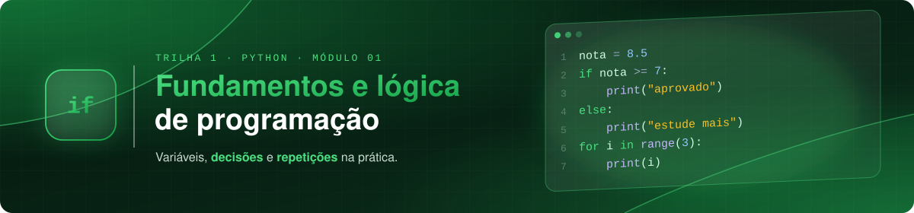

<a href="../README.md">🏠 Início</a> &nbsp;·&nbsp; <a href="../ROADMAP.md">🗺️ Roadmap</a> &nbsp;·&nbsp; <a href="../PROGRESSO.md">✅ Progresso</a> &nbsp;·&nbsp; <a href="../Projetos/README.md">🚀 Projetos</a>

  

## 🧩 O problema

Antes de qualquer biblioteca ou framework, preciso entender como um programa pensa: guardar valores, tomar decisões e repetir tarefas. Sem essa base, o resto vira código copiado que eu não saberia explicar.

## 👥 Para quem

Para quem está começando em programação e quer acompanhar o raciocínio por trás de cada solução. E para quem avalia o repositório e quer ver a base sendo construída com calma, na ordem certa.

## 🧭 Como funciona

**📚 Assuntos, na ordem de estudo**

1. Saída e entrada de dados (`print`, `input`)
2. Variáveis e tipos básicos (`int`, `float`, `str`, `bool`)
3. Operadores aritméticos, de comparação e lógicos
4. Condicionais: `if`, `elif`, `else`
5. Repetições: `while` e `for`
6. Lógica de programação aplicada a problemas simples

**➡️ Sequência.** A ordem acima é a ordem de estudo. Variáveis e condicionais vêm antes de lógicas mais elaboradas, e cada exercício só usa o que já foi apresentado.

**🗂️ Organização.** Os exercícios ficam em [`Exercicios/`](Exercicios/ex01_ola_python_lab.md). Cada um tem uma página `.md` (enunciado, solução comentada, saída esperada e aprendizado) e um arquivo `.py` com o mesmo código, para executar. A pasta `Desafios/` será criada quando houver desafios reais.

<b>📋 Como cada exercício é apresentado</b>

Cada exercício segue o mesmo padrão:

1. 🏷️ Identificação e título
2. 🎯 Objetivo
3. 🧩 Conceitos trabalhados
4. 📝 Enunciado
5. 💻 Resolução completa em Python, comentada em etapas numeradas
6. ▶️ Resultado esperado da execução
7. 📓 Registro do que foi aprendido
8. 🔌 Aplicação prática, quando houver conexão natural com desenvolvimento ou dados

## 🧪 Exercícios do primeiro lote

| # | Exercício | Conceitos | Status |
|---|---|---|---|
| 01 | [**Olá, Python Lab**](Exercicios/ex01_ola_python_lab.md) | `print()` · strings (texto entre aspas) · comentários com `#` · execução de cima para baixo | 🟢 concluído |
| 02 | [**Variáveis e tipos: ficha de estudante**](Exercicios/ex02_variaveis_e_tipos.md) | variáveis e atribuição (`=`) · tipos `str`, `int`, `float` e `bool` · `type()` · `print()` com vários valores | 🟢 concluído |
| 03 | [**Entrada de dados: saudação personalizada**](Exercicios/ex03_entrada_de_dados.md) | `input()` · retorno sempre em texto (`str`) · concatenação com `+` | 🟢 concluído |
| 04 | [**Média de três notas**](Exercicios/ex04_media_de_tres_notas.md) | operadores aritméticos (`+` e `/`) · variável que guarda o resultado calculado · f-string · formatação `:.2f` | 🟢 concluído |
| 05 | [**Conversão de tipos: Celsius para Fahrenheit**](Exercicios/ex05_conversao_de_temperatura.md) | conversão de tipos com `float()` · ordem das operações · f-string com `:.1f` | 🟢 concluído |
| 06 | [**Condicional: maior ou menor de idade**](Exercicios/ex06_maior_de_idade.md) | `if` e `else` · operadores de comparação · indentação · caso-limite | 🟢 concluído |
| 07 | [**if, elif e else: situação do aluno**](Exercicios/ex07_situacao_do_aluno.md) | `if` / `elif` / `else` · operador lógico `or` · validação de entradas · casos-limite | 🟢 concluído |
| 08 | [**Repetição: tabuada com for**](Exercicios/ex08_tabuada_com_for.md) | laço `for` · `range()` · variável do laço · f-string | 🟢 concluído |

**Como executar:** a partir da raiz do repositório, rode por exemplo `python 01_Fundamentos/Exercicios/ex01_ola_python_lab.py`. Os exercícios com `input()` esperam que você digite as respostas no terminal.

**Testado com:** Python 3.13. Os exercícios usam só recursos básicos da linguagem, como f-strings (Python 3.6 em diante).

Sequência deste lote: saída de dados → variáveis e tipos → entrada de dados → operadores e f-string → conversão de tipos → `if/else` → `if/elif/else` → `for`. Ainda faltam, para fechar o módulo, itens como o laço `while` e mais prática com operadores lógicos.

## 🔗 Conexões com outros módulos

| Módulo | Relação |
|---|---|
| [**📊 06 · Data Analytics**](../06_Data_analytics/README.md) | variáveis, condicionais e repetições como lógica de processamento de dados |
| [**🔄 08 · Engenharia de Dados**](../08_Engenharia_de_dados/README.md) | regras de transformação e validação de registros |

## 🛠️ Tecnologia

Python puro (biblioteca padrão), sem dependências externas.

## 📍 Status

> [!NOTE]
> 🟡 **Em andamento.** O primeiro lote tem 8 exercícios escritos, executados com Python 3.13 e com as saídas conferidas. Ainda faltam assuntos do módulo e a minha revisão. O andamento real fica em [`PROGRESSO.md`](../PROGRESSO.md).

← <a href="../README.md">🏠 Início</a> &nbsp;·&nbsp; <a href="../02_Estruturas_de_dados/README.md">🧱 02 · Estruturas de dados</a> →

