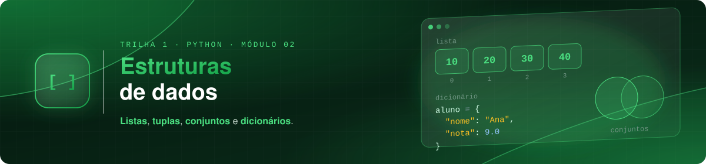

<a href="../README.md">🏠 Início</a> &nbsp;·&nbsp; <a href="../ROADMAP.md">🗺️ Roadmap</a> &nbsp;·&nbsp; <a href="../PROGRESSO.md">✅ Progresso</a> &nbsp;·&nbsp; <a href="../Projetos/README.md">🚀 Projetos</a>

  

## 🧩 O problema

Quase todo problema real envolve vários valores ao mesmo tempo. Sem estruturas de dados, a única saída seria criar uma variável para cada informação. Este módulo trata de organizar, percorrer e buscar dados em coleções.

## 👥 Para quem

Para quem já domina o básico de variáveis e repetições e quer aprender a lidar com conjuntos de informações. E para quem avalia e quer ver como organizo dados antes de chegar às bibliotecas.

## 🧭 Como funciona

**📚 Assuntos, na ordem de estudo**

1. Listas
2. Tuplas
3. Conjuntos
4. Dicionários
5. Compreensões de lista
6. Combinação de estruturas (por exemplo, lista de dicionários)

**➡️ Sequência.** Começa pelas listas, que reaproveitam as repetições do módulo 01, e avança para estruturas que exigem mais atenção, como dicionários e conjuntos.

**🗂️ Organização.** Os exercícios ficarão em `Exercicios/` e os desafios em `Desafios/`. Essas pastas serão criadas junto com o primeiro conteúdo real.

<b>📋 Como cada exercício é apresentado</b>

Cada exercício segue o mesmo padrão:

1. 🏷️ Identificação e título
2. 🎯 Objetivo
3. 🧩 Conceitos trabalhados
4. 📝 Enunciado
5. 💻 Resolução completa em Python, comentada em etapas numeradas
6. ▶️ Resultado esperado da execução
7. 📓 Registro do que foi aprendido
8. 🔌 Aplicação prática, quando houver conexão natural com desenvolvimento ou dados

## 🔗 Conexões com outros módulos

| Módulo | Relação |
|---|---|
| [**📊 06 · Data Analytics**](../06_Data_analytics/README.md) | listas e dicionários como ponto de partida para entender tabelas |

## 🛠️ Tecnologia

Python puro (biblioteca padrão), sem dependências externas.

## 📍 Status

> [!NOTE]
> ⚪ **Não iniciado.** Nenhum exercício concluído ainda. O andamento real fica em [`PROGRESSO.md`](../PROGRESSO.md).

← <a href="../01_Fundamentos/README.md">🌱 01 · Fundamentos</a> &nbsp;·&nbsp; <a href="../03_Funcoes_e_algoritmos/README.md">⚙️ 03 · Funções e algoritmos</a> →

