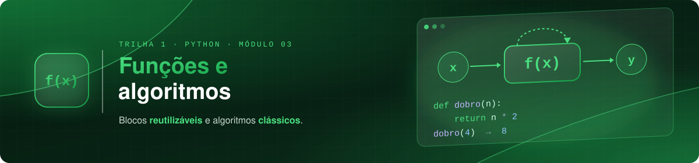

<a href="../README.md">🏠 Início</a> &nbsp;·&nbsp; <a href="../ROADMAP.md">🗺️ Roadmap</a> &nbsp;·&nbsp; <a href="../PROGRESSO.md">✅ Progresso</a> &nbsp;·&nbsp; <a href="../Projetos/README.md">🚀 Projetos</a>

  

## 🧩 O problema

Repetir o mesmo trecho de código em vários lugares é o caminho mais curto para o erro. Funções dão nome e reuso à lógica, e os algoritmos clássicos mostram como resolver um problema em passos bem definidos.

## 👥 Para quem

Para quem quer sair do código escrito de cima para baixo e começar a organizá-lo. E para quem avalia e quer ver capacidade de decompor um problema em partes.

## 🧭 Como funciona

**📚 Assuntos, na ordem de estudo**

1. Definição de funções, parâmetros e retorno
2. Parâmetros opcionais e valores padrão
3. Escopo de variáveis
4. Recursão
5. Algoritmos de busca
6. Algoritmos de ordenação

**➡️ Sequência.** Funções vêm antes de qualquer exigência de modularização. Os algoritmos entram depois, usando as estruturas do módulo 02.

**🗂️ Organização.** Os exercícios ficarão em `Exercicios/` e os desafios em `Desafios/`. Essas pastas serão criadas junto com o primeiro conteúdo real.

<b>📋 Como cada exercício é apresentado</b>

Cada exercício segue o mesmo padrão:

1. 🏷️ Identificação e título
2. 🎯 Objetivo
3. 🧩 Conceitos trabalhados
4. 📝 Enunciado
5. 💻 Resolução completa em Python, comentada em etapas numeradas
6. ▶️ Resultado esperado da execução
7. 📓 Registro do que foi aprendido
8. 🔌 Aplicação prática, quando houver conexão natural com desenvolvimento ou dados

## 🔗 Conexões com outros módulos

| Módulo | Relação |
|---|---|
| [**📊 06 · Data Analytics**](../06_Data_analytics/README.md) | funções reutilizáveis de tratamento e transformação de dados |
| [**🔄 08 · Engenharia de Dados**](../08_Engenharia_de_dados/README.md) | etapas reaproveitáveis de pipelines |

## 🛠️ Tecnologia

Python puro (biblioteca padrão), sem dependências externas.

## 📍 Status

> [!NOTE]
> ⚪ **Não iniciado.** Nenhum exercício concluído ainda. O andamento real fica em [`PROGRESSO.md`](../PROGRESSO.md).

← <a href="../02_Estruturas_de_dados/README.md">🧱 02 · Estruturas de dados</a> &nbsp;·&nbsp; <a href="../04_Python_intermediario/README.md">📂 04 · Python intermediário</a> →

