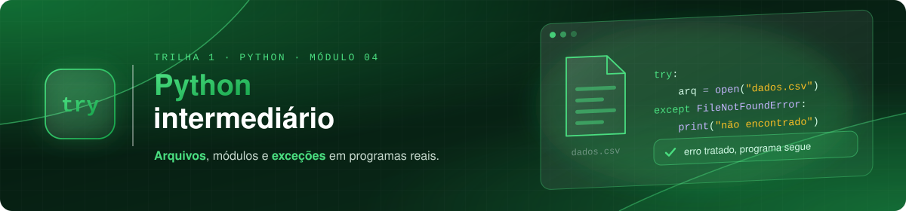

<a href="../README.md">🏠 Início</a> &nbsp;·&nbsp; <a href="../ROADMAP.md">🗺️ Roadmap</a> &nbsp;·&nbsp; <a href="../PROGRESSO.md">✅ Progresso</a> &nbsp;·&nbsp; <a href="../Projetos/README.md">🚀 Projetos</a>

  

## 🧩 O problema

Programas reais não vivem só de variáveis na memória: leem e escrevem arquivos, usam código de outros arquivos e precisam sobreviver a erros. Este módulo trata desse mundo fora do script isolado.

## 👥 Para quem

Para quem já escreve funções e quer dar o passo seguinte rumo a programas mais próximos do uso real. E para quem avalia e quer ver como lido com arquivos e falhas.

## 🧭 Como funciona

**📚 Assuntos, na ordem de estudo**

1. Leitura e escrita de arquivos
2. Módulos e importação
3. Bibliotecas da biblioteca padrão
4. Tratamento de exceções (`try`, `except`, `finally`)
5. Organização de código em vários arquivos

**➡️ Sequência.** Depende de funções e estruturas de dados. Arquivos e exceções vêm juntos sempre que possível, já que lidar com arquivos é onde os erros aparecem.

**🗂️ Organização.** Os exercícios ficarão em `Exercicios/` e os desafios em `Desafios/`. Essas pastas serão criadas junto com o primeiro conteúdo real.

<b>📋 Como cada exercício é apresentado</b>

Cada exercício segue o mesmo padrão:

1. 🏷️ Identificação e título
2. 🎯 Objetivo
3. 🧩 Conceitos trabalhados
4. 📝 Enunciado
5. 💻 Resolução completa em Python, comentada em etapas numeradas
6. ▶️ Resultado esperado da execução
7. 📓 Registro do que foi aprendido
8. 🔌 Aplicação prática, quando houver conexão natural com desenvolvimento ou dados

## 🔗 Conexões com outros módulos

| Módulo | Relação |
|---|---|
| [**📊 06 · Data Analytics**](../06_Data_analytics/README.md) | leitura de bases de dados e uso de bibliotecas |
| [**🔄 08 · Engenharia de Dados**](../08_Engenharia_de_dados/README.md) | arquivos, exceções e logs em fluxos de dados |

## 🛠️ Tecnologia

Python puro (biblioteca padrão), sem dependências externas.

## 📍 Status

> [!NOTE]
> ⚪ **Não iniciado.** Nenhum exercício concluído ainda. O andamento real fica em [`PROGRESSO.md`](../PROGRESSO.md).

← <a href="../03_Funcoes_e_algoritmos/README.md">⚙️ 03 · Funções e algoritmos</a> &nbsp;·&nbsp; <a href="../05_Poo/README.md">🏗️ 05 · POO</a> →

