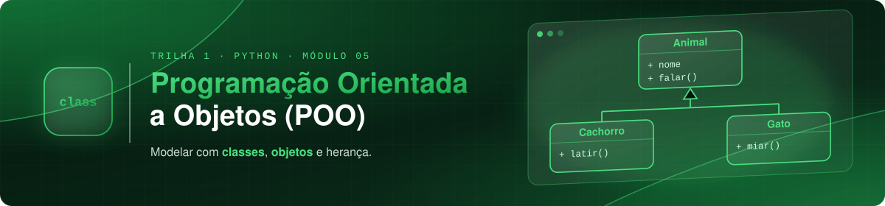

<a href="../README.md">🏠 Início</a> &nbsp;·&nbsp; <a href="../ROADMAP.md">🗺️ Roadmap</a> &nbsp;·&nbsp; <a href="../PROGRESSO.md">✅ Progresso</a> &nbsp;·&nbsp; <a href="../Projetos/README.md">🚀 Projetos</a>

  

## 🧩 O problema

Conforme os programas crescem, dados e comportamentos soltos ficam difíceis de manter. A POO propõe agrupar os dois em objetos, o que ajuda a organizar aplicações em partes reutilizáveis.

## 👥 Para quem

Para quem já domina funções e quer aprender a modelar problemas com classes. E para quem avalia e quer ver como organizo um programa maior.

## 🧭 Como funciona

**📚 Assuntos, na ordem de estudo**

1. Classes e objetos
2. Atributos e métodos
3. Construtores (`__init__`) e `self`
4. Encapsulamento
5. Herança
6. Polimorfismo
7. Composição
8. Métodos especiais
9. Organização do código em módulos
10. Pequenos sistemas que integram os conceitos

**➡️ Sequência.** Só começa depois de funções (módulo 03) e do básico de módulos e exceções (módulo 04). Classes e objetos entram antes de herança e polimorfismo.

**🗂️ Organização.** Os exercícios ficarão em `Exercicios/` e os desafios em `Desafios/`. Essas pastas serão criadas junto com o primeiro conteúdo real.

<b>📋 Como cada exercício é apresentado</b>

Cada exercício segue o mesmo padrão:

1. 🏷️ Identificação e título
2. 🎯 Objetivo
3. 🧩 Conceitos trabalhados
4. 📝 Enunciado
5. 💻 Resolução completa em Python, comentada em etapas numeradas
6. ▶️ Resultado esperado da execução
7. 📓 Registro do que foi aprendido
8. 🔌 Aplicação prática, quando houver conexão natural com desenvolvimento ou dados

## 🔗 Conexões com outros módulos

| Módulo | Relação |
|---|---|
| [**🔄 08 · Engenharia de Dados**](../08_Engenharia_de_dados/README.md) | organização de componentes reutilizáveis em pipelines |

## 🛠️ Tecnologia

Python puro (biblioteca padrão), sem dependências externas.

## 📍 Status

> [!NOTE]
> ⚪ **Não iniciado.** Nenhum exercício concluído ainda. O andamento real fica em [`PROGRESSO.md`](../PROGRESSO.md).

← <a href="../04_Python_intermediario/README.md">📂 04 · Python intermediário</a> &nbsp;·&nbsp; <a href="../06_Data_analytics/README.md">📊 06 · Data Analytics</a> →

