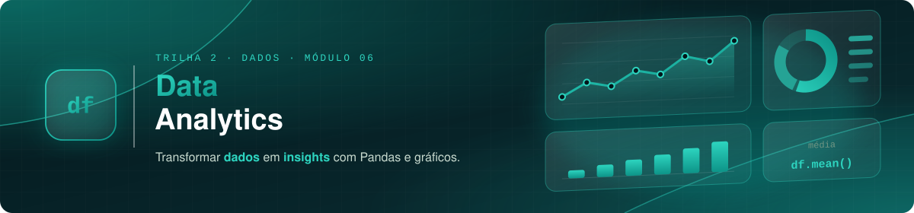

<a href="../README.md">🏠 Início</a> &nbsp;·&nbsp; <a href="../ROADMAP.md">🗺️ Roadmap</a> &nbsp;·&nbsp; <a href="../PROGRESSO.md">✅ Progresso</a> &nbsp;·&nbsp; <a href="../Projetos/README.md">🚀 Projetos</a>

    

  

## 🧩 O problema

Dados brutos raramente respondem perguntas por conta própria: têm valores ausentes, duplicados e inconsistências. Este módulo estuda como o Python ajuda a limpar, organizar e interpretar uma base até chegar a insights.

## 👥 Para quem

Para quem quer aplicar a base de Python em análise de dados. E para quem avalia e quer ver capacidade de tratar e interpretar informações, não só de escrever sintaxe.

## 🧭 Como funciona

**📚 Assuntos, na ordem de estudo**

1. NumPy e Pandas
2. Leitura de arquivos CSV, Excel e JSON
3. Limpeza e tratamento de dados
4. Identificação de valores ausentes e duplicados
5. Análise exploratória de dados (EDA)
6. Estatística descritiva aplicada
7. Agrupamentos e agregações
8. Visualização com Matplotlib e Seaborn
9. Identificação de padrões e geração de insights

**💡 Exemplos de aplicação**

- Explorar uma base de vendas
- Identificar produtos ou categorias com maior desempenho
- Analisar tendências ao longo do tempo
- Encontrar inconsistências em uma base
- Produzir visualizações que ajudem a interpretar resultados

**➡️ Sequência.** A progressão é gradual: nenhuma biblioteca será usada antes de os conhecimentos necessários terem sido estudados.

**🗂️ Organização.** A organização interna será definida conforme o conteúdo real. Há uma proposta inicial de subpastas (`Pandas/`, `Numpy/`, `Analise_exploratoria/`, `Visualizacao/`), que só serão criadas quando houver material para elas.

**📦 Dados.** Serão fictícios ou de fontes públicas adequadas, com origem e condições de uso documentadas.

## 🔗 Conexões com outros módulos

| Módulo | Relação |
|---|---|
| [**🌱 01 · Fundamentos**](../01_Fundamentos/README.md) | condicionais e repetições como lógica de processamento |
| [**🧱 02 · Estruturas de dados**](../02_Estruturas_de_dados/README.md) | listas e dicionários como ponto de partida para entender tabelas |
| [**⚙️ 03 · Funções e algoritmos**](../03_Funcoes_e_algoritmos/README.md) | funções reutilizáveis de tratamento e transformação |
| [**📂 04 · Python intermediário**](../04_Python_intermediario/README.md) | arquivos, bibliotecas e exceções |

## 🛠️ Tecnologia

Previstas: NumPy, Pandas, Matplotlib e Seaborn. Ainda não foram estudadas e só passam a "em uso" depois de praticadas.

## 📍 Status

> [!NOTE]
> ⚪ **Não iniciado.** Módulo ainda não iniciado. Nenhuma biblioteca de dados foi estudada até agora. O andamento real fica em [`PROGRESSO.md`](../PROGRESSO.md).

← <a href="../05_Poo/README.md">🏗️ 05 · POO</a> &nbsp;·&nbsp; <a href="../07_Business_intelligence/README.md">📈 07 · Business Intelligence</a> →

