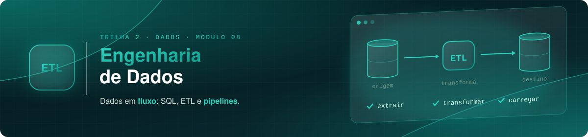

<a href="../README.md">🏠 Início</a> &nbsp;·&nbsp; <a href="../ROADMAP.md">🗺️ Roadmap</a> &nbsp;·&nbsp; <a href="../PROGRESSO.md">✅ Progresso</a> &nbsp;·&nbsp; <a href="../Projetos/README.md">🚀 Projetos</a>

 

  

## 🧩 O problema

Dados raramente nascem onde serão usados. Alguém precisa extrair de uma origem, transformar e carregar em outro destino, de forma repetível e com tratamento de erros. Este módulo estuda os fundamentos dessas etapas em Python.

## 👥 Para quem

Para quem quer entender como os dados chegam até a análise. E para quem avalia e quer ver capacidade de construir e documentar um fluxo, não só de consultar uma base.

## 🧭 Como funciona

**📚 Assuntos, na ordem de estudo**

1. Integração com bancos de dados
2. SQL e Python
3. Conexões com MySQL e outros bancos relacionais
4. Manipulação de arquivos e volumes de dados
5. Processos ETL e ELT
6. Extração, transformação e carregamento de dados
7. Consumo de APIs
8. Tratamento de erros e logs
9. Automação de pipelines
10. Introdução à orquestração de fluxos de dados

**💡 Exemplos de aplicação**

- Extrair informações de arquivos ou bancos de dados
- Transformar e padronizar registros
- Carregar dados tratados em outra tabela ou arquivo
- Automatizar etapas de um processo de integração
- Construir um pipeline simples e documentar suas etapas

**➡️ Sequência.** Depende de arquivos e exceções (módulo 04) e de manipulação de dados (módulo 06). POO (módulo 05) ajuda na organização de pipelines.

**🗂️ Organização.** A organização interna será definida conforme o conteúdo real. Propostas iniciais de subpastas: `Sql_python/`, `Etl_elt/`, `Pipelines/` e `Integracao_apis/`, criadas somente quando houver material.

**📦 Dados.** Serão fictícios ou de fontes públicas adequadas, com origem e condições de uso documentadas.

## 🔗 Conexões com outros módulos

| Módulo | Relação |
|---|---|
| [**📂 04 · Python intermediário**](../04_Python_intermediario/README.md) | arquivos e tratamento de exceções |
| [**🏗️ 05 · POO**](../05_Poo/README.md) | organização de componentes reutilizáveis |
| [**📊 06 · Data Analytics**](../06_Data_analytics/README.md) | manipulação e transformação de dados |

## 🛠️ Tecnologia

Previstas: SQL, MySQL e outros bancos relacionais, consumo de APIs e logs. Ainda não foram estudados.

## 📍 Status

> [!NOTE]
> ⚪ **Não iniciado.** Módulo ainda não iniciado. Nenhum banco de dados ou pipeline foi construído até agora. O andamento real fica em [`PROGRESSO.md`](../PROGRESSO.md).

← <a href="../07_Business_intelligence/README.md">📈 07 · Business Intelligence</a> &nbsp;·&nbsp; <a href="../Projetos/README.md">🚀 Projetos</a> →

