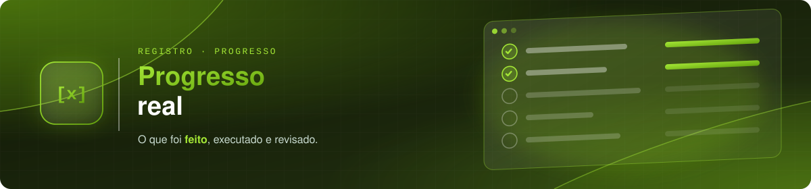

<a href="README.md">🏠 Início</a> &nbsp;·&nbsp; <a href="ROADMAP.md">🗺️ Roadmap</a> &nbsp;·&nbsp; <a href="Projetos/README.md">🚀 Projetos</a>

Registro do que foi realmente feito.

| Marca | Significado |
|---|---|
| `[ ]` ⚪ | pendente |
| `[~]` 🟡 | em andamento |
| `[x]` 🟢 | concluído (desenvolvido e executado) |
| `[r]` 🔵 | revisado (conferido depois de concluído) |

> [!IMPORTANT]
> Nada aqui é marcado como concluído antes de existir, rodar e ser revisado.
>
> Os exercícios do primeiro lote estão como `[x]`: escritos, executados e com as saídas conferidas. A marca `[r]` entra depois da minha própria revisão.

**📅 Estrutura criada em:** 17/11/2026

**🎯 Exercícios concluídos:** `█░░░░░░░░░░░░░░░░░░░` 8 de ~150 (5%)

## 📋 Resumo por módulo

| Módulo | Status | Exercícios |
|---|---|---|
| [**🌱 01 · Fundamentos**](01_Fundamentos/README.md) | 🟡 em andamento | 8 |
| [**🧱 02 · Estruturas de dados**](02_Estruturas_de_dados/README.md) | ⚪ não iniciado | 0 |
| [**⚙️ 03 · Funções e algoritmos**](03_Funcoes_e_algoritmos/README.md) | ⚪ não iniciado | 0 |
| [**📂 04 · Python intermediário**](04_Python_intermediario/README.md) | ⚪ não iniciado | 0 |
| [**🏗️ 05 · POO**](05_Poo/README.md) | ⚪ não iniciado | 0 |
| [**📊 06 · Data Analytics**](06_Data_analytics/README.md) | ⚪ não iniciado | 0 |
| [**📈 07 · Business Intelligence**](07_Business_intelligence/README.md) | ⚪ não iniciado | 0 |
| [**🔄 08 · Engenharia de Dados**](08_Engenharia_de_dados/README.md) | ⚪ não iniciado | 0 |
| [**🚀 Projetos**](Projetos/README.md) | ⚪ nenhum projeto | 0 |

## 🏗️ Estrutura do repositório

- [x] Pastas dos módulos e de `Projetos`
- [x] `README.md` principal
- [x] `ROADMAP.md`
- [x] `PROGRESSO.md`
- [x] READMEs dos módulos 01 a 08
- [x] `Projetos/README.md`
- [x] Identidade visual (banners e divisores em `Assets/`)
- [x] Links internos e imagens da estrutura verificados (17/11/2026)
- [x] Links verificados após o primeiro lote de exercícios (17/11/2026)
- [ ] Verificar os links novamente a cada novo lote de exercícios

## 🐍 Trilha 1 · Python: fundamentos e desenvolvimento

### 🌱 01 · Fundamentos e lógica

**Primeiro lote** (escrito, executado e com saídas conferidas; revisão pessoal pendente):

- [x] [01 · Olá, Python Lab](01_Fundamentos/Exercicios/ex01_ola_python_lab.md)
- [x] [02 · Variáveis e tipos: ficha de estudante](01_Fundamentos/Exercicios/ex02_variaveis_e_tipos.md)
- [x] [03 · Entrada de dados: saudação personalizada](01_Fundamentos/Exercicios/ex03_entrada_de_dados.md)
- [x] [04 · Média de três notas](01_Fundamentos/Exercicios/ex04_media_de_tres_notas.md)
- [x] [05 · Conversão de tipos: Celsius para Fahrenheit](01_Fundamentos/Exercicios/ex05_conversao_de_temperatura.md)
- [x] [06 · Condicional: maior ou menor de idade](01_Fundamentos/Exercicios/ex06_maior_de_idade.md)
- [x] [07 · if, elif e else: situação do aluno](01_Fundamentos/Exercicios/ex07_situacao_do_aluno.md)
- [x] [08 · Repetição: tabuada com for](01_Fundamentos/Exercicios/ex08_tabuada_com_for.md)

**Assuntos do módulo:**

- [~] Saída e entrada de dados (`print` e `input` nos exercícios 01 e 03)
- [~] Variáveis e tipos (exercícios 02 e 05)
- [~] Operadores (aritméticos, de comparação e `or`; faltam mais práticas com `and` e `not`)
- [~] Condicionais (`if/else` e `if/elif/else`; faltam condições aninhadas)
- [~] Repetições (`for` feito; falta `while`)
- [ ] Desafios do módulo

### 🧱 02 · Estruturas de dados

- [ ] Listas
- [ ] Tuplas
- [ ] Conjuntos
- [ ] Dicionários
- [ ] Compreensões de lista
- [ ] Desafios do módulo

### ⚙️ 03 · Funções e algoritmos

- [ ] Funções, parâmetros e retorno
- [ ] Escopo
- [ ] Recursão
- [ ] Busca e ordenação
- [ ] Desafios do módulo

### 📂 04 · Python intermediário

- [ ] Arquivos
- [ ] Módulos e bibliotecas
- [ ] Exceções
- [ ] Desafios do módulo

### 🏗️ 05 · Programação Orientada a Objetos

- [ ] Classes e objetos
- [ ] Atributos, métodos, `__init__` e `self`
- [ ] Encapsulamento
- [ ] Herança e polimorfismo
- [ ] Composição
- [ ] Métodos especiais
- [ ] Organização do código em módulos
- [ ] Desafios do módulo

## 🧪 Trilha 2 · Python aplicado a dados

### 📊 06 · Data Analytics

- [ ] NumPy e Pandas
- [ ] Leitura de CSV, Excel e JSON
- [ ] Limpeza de dados
- [ ] Análise exploratória
- [ ] Visualização

### 📈 07 · Business Intelligence

- [ ] Preparação de dados
- [ ] Indicadores
- [ ] Automação de relatórios
- [ ] Python e Power BI

### 🔄 08 · Engenharia de Dados

- [ ] SQL e Python
- [ ] ETL e ELT
- [ ] APIs
- [ ] Logs e tratamento de erros
- [ ] Pipelines

## 🚀 Projetos

- [ ] Nenhum projeto iniciado

<a href="#">↑ voltar ao topo</a>

