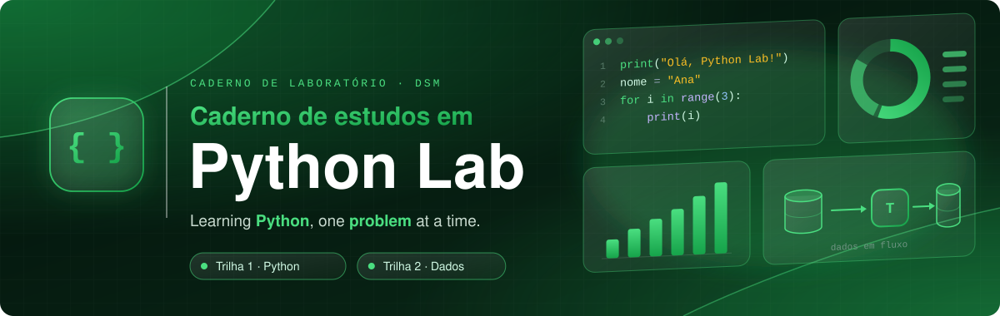
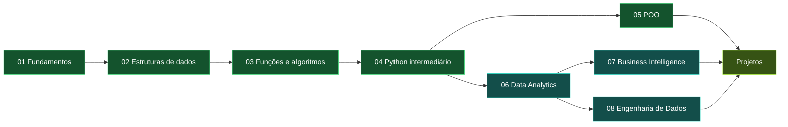

<a id="topo"></a>


<p align="center">
<a href="#trilhas">🗂️ <b>Trilhas</b></a> &nbsp;·&nbsp; <a href="ROADMAP.md">🗺️ <b>Roadmap</b></a> &nbsp;·&nbsp; <a href="PROGRESSO.md">✅ <b>Progresso</b></a> &nbsp;·&nbsp; <a href="Projetos/README.md">🚀 <b>Projetos</b></a> &nbsp;·&nbsp; <a href="#executar">▶️ <b>Como executar</b></a>
</p>

<p align="center">
    
</p>

<p align="center">
  
</p>

## 🧩 O problema

Um repositório de estudos costuma guardar o código e perder o raciocínio. Quem abre uma pasta de exercícios vê respostas prontas, mas não vê por que cada variável, função ou estrutura foi escolhida.

**O código está lá. A história, não.**

Decidi construir o Python Lab para guardar as duas coisas. Cada exercício traz a solução e o caminho até ela, explicado passo a passo, como se eu estivesse pensando em voz alta. E o progresso é registrado sem maquiagem: só aparece como concluído o que foi desenvolvido, executado e revisado.


## 👥 Para quem

| Quem | O que encontra aqui |
|---|---|
| 🎓 **Eu, estudante de DSM na FATEC Zona Sul** | Um registro da minha evolução e um lugar para consultar o que já resolvi. |
| 🔎 **Quem avalia o portfólio** | O que o repositório é, para quem foi feito, como foi construído e como rodar, sem precisar me perguntar. |
| 🌱 **Quem está começando em Python** | Exercícios com o raciocínio explicado, para acompanhar a construção da solução. |

Este não é um curso, uma apostila ou uma documentação oficial. Escrevo como quem está aprendendo e praticando.


## 🧭 Como funciona

**🛤️ Duas trilhas.** Primeiro construo a base da linguagem (Trilha 1). Depois aplico esses conhecimentos em contextos profissionais ligados a dados (Trilha 2). A segunda complementa a primeira, sem substituí-la.

**📏 Um padrão para cada exercício.** O planejamento prevê aproximadamente 150 exercícios, distribuídos conforme a complexidade de cada módulo, sem divisão artificial. Todos seguem a mesma estrutura: objetivo, conceitos, enunciado, resolução comentada, resultado esperado, o que aprendi e, quando faz sentido, uma aplicação prática.

**💬 Código explicado, não só escrito.** Os comentários seguem o meu raciocínio, em etapas numeradas, e explicam a intenção por trás de cada escolha, não só o que a linha faz.

<details>
<summary><b>👀 Ver o formato de um exercício</b> (exemplo do estilo, não é um exercício concluído do repositório)</summary>

```python
# 1. Variáveis das notas
# Utilizamos variáveis para armazenar as notas dos usuários.
nota1 = 8.5
nota2 = 7.0
nota3 = 9.0


# 2. Variável da média
# Criamos outra variável para armazenar o resultado de uma operação matemática.
# Dessa forma, podemos chamar media posteriormente para acessar o resultado,
# sem precisar realizar o cálculo novamente.
media = (nota1 + nota2 + nota3) / 3


# 3. Exibição do resultado
# O print() vai exibir o resultado do código na tela.
# O f antes das aspas indica que estamos utilizando uma f-string.
# Esse recurso permite combinar textos com valores de variáveis na mesma frase.
# As chaves {} indicam onde queremos inserir o valor de uma variável.
# Por exemplo, {media} será substituído pelo valor armazenado em media.
# :.2f define que o número será apresentado com duas casas decimais.
# Por exemplo, 8.1666 será exibido como 8.17.
print(f"Média final: {media:.2f}")
```

```text
Média final: 8.17
```

</details>

> [!IMPORTANT]
> **Registro honesto.** Um item só é marcado como concluído depois de desenvolvido, executado e revisado. Dados são fictícios ou de fontes públicas, com origem documentada. Projetos só entram quando foram de fato executados.

<a id="trilhas"></a>


## 🗂️ Trilhas e módulos

### 🐍 Trilha 1 · Python: fundamentos e desenvolvimento

| Módulo | O que estuda | Status |
|---|---|---|
| [**🌱 01 · Fundamentos e lógica**](01_Fundamentos/README.md) | variáveis, operadores, condicionais, repetições | 🟡 em andamento |
| [**🧱 02 · Estruturas de dados**](02_Estruturas_de_dados/README.md) | listas, tuplas, conjuntos, dicionários | ⚪ não iniciado |
| [**⚙️ 03 · Funções e algoritmos**](03_Funcoes_e_algoritmos/README.md) | funções, recursão, busca e ordenação | ⚪ não iniciado |
| [**📂 04 · Python intermediário**](04_Python_intermediario/README.md) | arquivos, módulos, exceções, bibliotecas | ⚪ não iniciado |
| [**🏗️ 05 · Programação Orientada a Objetos**](05_Poo/README.md) | classes, objetos, herança, encapsulamento | ⚪ não iniciado |

### 🧪 Trilha 2 · Python aplicado a dados

| Módulo | O que estuda | Status |
|---|---|---|
| [**📊 06 · Data Analytics**](06_Data_analytics/README.md) | NumPy, Pandas, EDA, visualização | ⚪ não iniciado |
| [**📈 07 · Business Intelligence**](07_Business_intelligence/README.md) | preparação de dados, indicadores, Power BI | ⚪ não iniciado |
| [**🔄 08 · Engenharia de Dados**](08_Engenharia_de_dados/README.md) | SQL, ETL/ELT, pipelines, APIs | ⚪ não iniciado |




## 📌 Navegação e progresso

| Arquivo | Para que serve |
|---|---|
| [**🗺️ ROADMAP.md**](ROADMAP.md) | O plano das duas trilhas, com assuntos previstos e dependências. |
| [**✅ PROGRESSO.md**](PROGRESSO.md) | Checklists do que está pendente, em andamento, concluído e revisado. |
| [**📓 Primeiro lote de exercícios**](01_Fundamentos/Exercicios/ex01_ola_python_lab.md) | Oito exercícios do módulo 01, para começar pelo primeiro. |
| [**🚀 Projetos**](Projetos/README.md) | Aplicações práticas futuras que integrem os módulos. Nenhuma ainda. |

As subpastas `Exercicios/` e `Desafios/` de cada módulo são criadas quando o primeiro conteúdo real existir. Não há pastas vazias para preencher espaço.

<a id="executar"></a>


## ▶️ Como executar

1. Instale o Python 3.
2. Clone o repositório:

   ```bash
   git clone https://github.com/maxgodoydev/python-lab.git
   cd python-lab
   ```

3. Execute um exercício diretamente:

   ```bash
   python 01_Fundamentos/Exercicios/ex01_ola_python_lab.py
   ```

Os exercícios foram executados com Python 3.13 e usam só recursos básicos da linguagem (como f-strings, do Python 3.6 em diante). Os módulos 01 a 05 usam apenas Python puro, sem dependências externas. Quando a Trilha 2 começar, as bibliotecas necessárias serão documentadas no README do módulo correspondente.


## 🛠️ Tecnologias

Só o que já faz parte do projeto aparece como **em uso**: Python 3, Git, GitHub, Markdown e Mermaid.

> [!TIP]
> Bibliotecas e ferramentas de dados (NumPy, Pandas, Matplotlib, Power BI e outras) aparecem nos READMEs da Trilha 2 como **previstas**. Só viram "em uso" depois de estudadas e praticadas.


<p align="center">
<a href="#topo">↑ voltar ao topo</a>
</p>
