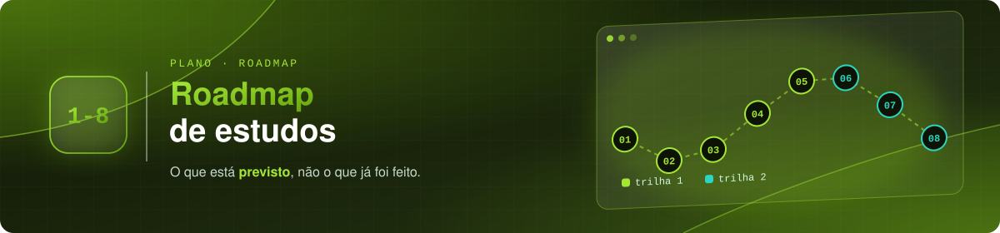
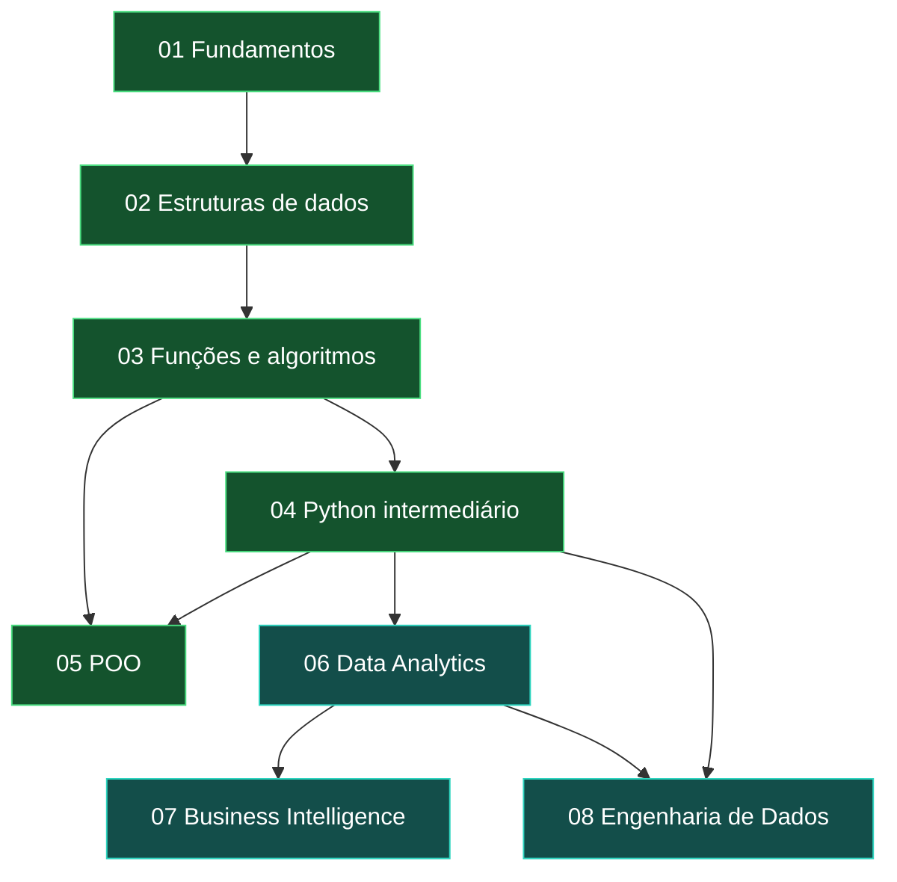

<a href="README.md">🏠 Início</a> &nbsp;·&nbsp; <a href="PROGRESSO.md">✅ Progresso</a> &nbsp;·&nbsp; <a href="Projetos/README.md">🚀 Projetos</a>

Plano de estudos do Python Lab. Descreve o que está **previsto**, não o que já foi feito. Para o andamento real, veja [`PROGRESSO.md`](PROGRESSO.md).

O total estimado é de aproximadamente 150 exercícios nos cinco módulos da Trilha 1. A quantidade por módulo varia conforme a complexidade.

## 🔭 Visão geral

| Módulo | Trilha | Depende de |
|---|---|---|
| [**🌱 01 · Fundamentos**](01_Fundamentos/README.md) | 1 | nada |
| [**🧱 02 · Estruturas de dados**](02_Estruturas_de_dados/README.md) | 1 | 01 (principalmente repetições e condicionais) |
| [**⚙️ 03 · Funções e algoritmos**](03_Funcoes_e_algoritmos/README.md) | 1 | 01 e 02 |
| [**📂 04 · Python intermediário**](04_Python_intermediario/README.md) | 1 | 01, 02 e 03 |
| [**🏗️ 05 · POO**](05_Poo/README.md) | 1 | 03 e 04 |
| [**📊 06 · Data Analytics**](06_Data_analytics/README.md) | 2 | 01 a 04 (POO ajuda, mas não é pré-requisito) |
| [**📈 07 · Business Intelligence**](07_Business_intelligence/README.md) | 2 | 06 (a parte de SQL se beneficia de começar o 08) |
| [**🔄 08 · Engenharia de Dados**](08_Engenharia_de_dados/README.md) | 2 | 04 e 06 (POO ajuda na organização de pipelines) |

## 🐍 Trilha 1 · Python: fundamentos e desenvolvimento

### 🌱 01 · Fundamentos e lógica

→ [`01_Fundamentos`](01_Fundamentos/README.md)

- Saída e entrada de dados (`print`, `input`)
- Variáveis e tipos básicos (`int`, `float`, `str`, `bool`)
- Operadores aritméticos, de comparação e lógicos
- Condicionais: `if`, `elif`, `else`
- Repetições: `while` e `for`
- Lógica de programação aplicada a problemas simples

**Depende de:** nada.

### 🧱 02 · Estruturas de dados

→ [`02_Estruturas_de_dados`](02_Estruturas_de_dados/README.md)

- Listas
- Tuplas
- Conjuntos
- Dicionários
- Compreensões de lista
- Combinação de estruturas (por exemplo, lista de dicionários)

**Depende de:** 01 (principalmente repetições e condicionais).

### ⚙️ 03 · Funções e algoritmos

→ [`03_Funcoes_e_algoritmos`](03_Funcoes_e_algoritmos/README.md)

- Definição de funções, parâmetros e retorno
- Parâmetros opcionais e valores padrão
- Escopo de variáveis
- Recursão
- Algoritmos de busca
- Algoritmos de ordenação

**Depende de:** 01 e 02.

### 📂 04 · Python intermediário

→ [`04_Python_intermediario`](04_Python_intermediario/README.md)

- Leitura e escrita de arquivos
- Módulos e importação
- Bibliotecas da biblioteca padrão
- Tratamento de exceções (`try`, `except`, `finally`)
- Organização de código em vários arquivos

**Depende de:** 01, 02 e 03.

### 🏗️ 05 · Programação Orientada a Objetos

→ [`05_Poo`](05_Poo/README.md)

- Classes e objetos
- Atributos e métodos
- Construtores (`__init__`) e `self`
- Encapsulamento
- Herança
- Polimorfismo
- Composição
- Métodos especiais
- Organização do código em módulos
- Pequenos sistemas que integram os conceitos

**Depende de:** 03 e 04.

## 🧪 Trilha 2 · Python aplicado a dados

A Trilha 2 só começa depois que a base da Trilha 1 estiver construída. Ela aplica os conhecimentos anteriores, sem substituí-los.

### 📊 06 · Data Analytics

→ [`06_Data_analytics`](06_Data_analytics/README.md)

- NumPy e Pandas
- Leitura de arquivos CSV, Excel e JSON
- Limpeza e tratamento de dados
- Identificação de valores ausentes e duplicados
- Análise exploratória de dados (EDA)
- Estatística descritiva aplicada
- Agrupamentos e agregações
- Visualização com Matplotlib e Seaborn
- Identificação de padrões e geração de insights

**Depende de:** 01 a 04 (POO ajuda, mas não é pré-requisito).

### 📈 07 · Business Intelligence

→ [`07_Business_intelligence`](07_Business_intelligence/README.md)

- Preparação e transformação de dados
- Análise e validação de bases
- Geração e validação de indicadores
- Análises exploratórias para apoiar decisões
- Automação de relatórios
- Integração de Python com Power BI
- Integração entre Python, SQL e ferramentas de BI
- Aplicações práticas em dashboards e indicadores

**Depende de:** 06 (a parte de SQL se beneficia de começar o 08).

### 🔄 08 · Engenharia de Dados

→ [`08_Engenharia_de_dados`](08_Engenharia_de_dados/README.md)

- Integração com bancos de dados
- SQL e Python
- Conexões com MySQL e outros bancos relacionais
- Manipulação de arquivos e volumes de dados
- Processos ETL e ELT
- Extração, transformação e carregamento de dados
- Consumo de APIs
- Tratamento de erros e logs
- Automação de pipelines
- Introdução à orquestração de fluxos de dados

**Depende de:** 04 e 06 (POO ajuda na organização de pipelines).

## 🚀 Projetos

→ [`Projetos`](Projetos/README.md)

Aplicações que integram conhecimentos de vários módulos. Possibilidades futuras:

- Análise exploratória de uma base pública
- Relatório de indicadores com preparação de dados em Python
- Integração entre Python e um banco SQL
- Pipeline ETL simples
- Automação de uma rotina de tratamento de dados

## 🕸️ Mapa de dependências

<a href="#">↑ voltar ao topo</a>

